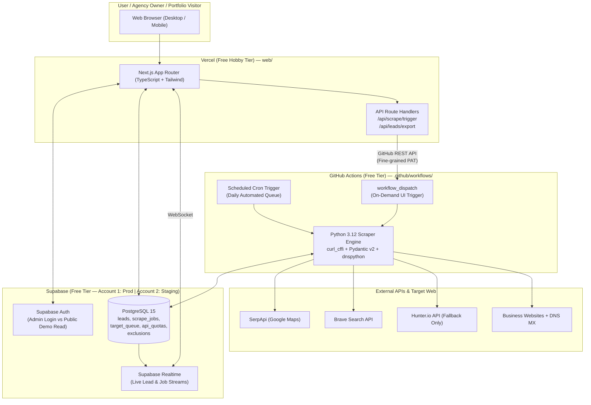

# ProspectIQ v3.0 — System Architecture & Technical Specification

> **Owner:** Muhammad Kamal  
> **Product:** Automated B2B Agency Prospecting & Web-Presence Intelligence Platform (Agency Client Acquisition + Portfolio Showcase)  
> **Deployment Stack:** Vercel (Free Hobby) + Supabase Postgres/Auth/Realtime (Free Tier) + GitHub Actions Auto-Scraper (Free Tier)  
> **Status:** v3.0 Target Architecture (Migrating from v2.0 Local SQLite CLI)

---

## 1. Architectural Vision & Why v3.0 Exists

ProspectIQ v2.0 established a clean local Python pipeline (`discovery -> validator -> extractor -> models -> database`), but forensic audits of live runs (`logs/app.log`) and deployment constraints exposed two major limitations:

1. **Garbage In, Garbage Out (Data Quality Gaps):**
   - Social URLs (`m.facebook.com/...`) returned by SerpApi were validated as "live websites" and burned Hunter.io credits on `facebook.com`.
   - `curl: (6)` DNS failures and Cloudflare `403` responses were falsely classified as `Website DEAD`, creating bad "No Website" pitches.
   - 90% of high-value Google Maps metadata (phone, rating, reviews, address, closed status, `place_id`) was discarded.
   - Hunter.io (50 free calls/month) ran *before* free on-site scraping, and domain deduplication ran *after* scraping.
   - Plaintext API keys appeared in debug URL logs.
2. **Local-Only Bottleneck:**
   - Local `leads.db` and `usage_tracker.json` cannot persist on stateless serverless platforms like Vercel, and Vercel Hobby's 10-second function timeout cannot run stealth multi-page scrapes.

**v3.0 solves both** with a 100% free-tier cloud architecture and a precision-filtered, scored, MX-verified scraping engine.

---

## 2. High-Level Cloud Architecture



### Multi-Project Free-Tier Hub Strategy (Supabase Project #2 — `prospectiq` Schema)
To keep your first Supabase project untouched and stay within Supabase's free 2-project limit while hosting multiple lightweight apps, **Supabase Project #2 acts as a Multi-Schema Hub** where each lightweight project owns its own isolated PostgreSQL schema (`prospectiq.*`, `<sibling_app>.*`, etc.):
- **Schema Namespace Isolation:** Every ProspectIQ table, index, view, and function lives exclusively inside `prospectiq.*`. Nothing is created in `public.*`, guaranteeing zero naming collisions with sibling projects.
- **Supabase Data API Exposure:** Add `prospectiq` alongside sibling schemas under **Project Settings -> Data API -> Exposed schemas** (e.g., `public, prospectiq, <other_app>`).
- **Client Targeting:** Frontend initializes `createClient(..., { db: { schema: 'prospectiq' } })` and Python targets `supabase.schema("prospectiq")`.
- **Shared-Project Guardrails (Mandatory for Co-Hosting):**
  1. **Zero `anon` DB Access:** Unauthenticated visitors NEVER touch Supabase; they experience 100% static client-side dummy data.
  2. **Owner-UUID Scoped RLS:** Because sibling apps in Project #2 share `auth.users`, EVERY RLS policy on `prospectiq.*` checks `auth.uid() = '<OWNER_USER_UUID>'::uuid` — never a generic `authenticated` role check. Even if another co-hosted app allows public signups, those users get zero rows from `prospectiq.*`.
  3. **Non-Destructive Scoped Migrations Only:** Never run `supabase db reset` on Project #2. All SQL files strictly target `prospectiq.*` idempotently.
  4. **Lightweight Resource Footprint:** ~1.5 KB/lead (~15–20 MB per 10k leads) leaves plenty of room in the shared 500 MB free cap; use REST/PostgREST or Transaction Pooler (port 6543) to preserve shared connection slots. Daily GitHub Actions cron runs also prevent the 7-day inactivity pause across the hub.

---

## 3. Repository Structure (v3.0 Monorepo)

```text
prospectiq-main/
├── ARCHITECTURE.md              # This file (v3.0 system architecture & DB schema)
├── rule.md                      # Engineering rules, stealth/quota guardrails, hard stops
├── phase-doc.md                 # 4-phase implementation & migration plan
├── design.md                    # Design system, component map, & Figma Pro prompt
├── memory.md                    # Running decision log, audit findings, & session state
├── AGENTS.md                    # Original hard-stop governance rules (preserved)
├── README.md                    # Public repo & deployment documentation
│
├── .github/
│   └── workflows/
│       └── auto-scrape.yml      # Cron + workflow_dispatch Python scraper runner
│
├── engine/                      # (or root Python modules until Phase 2 migration)
│   ├── config.py                # Env vars, defaults, scoring thresholds, blacklists
│   ├── logger.py                # Structured logger with automatic secret redaction
│   ├── stealth.py               # SOLE outbound HTTP gateway (curl_cffi + DNS fix + timing)
│   ├── tracker.py               # Supabase-backed monthly quota guard (SQLite fallback)
│   ├── discovery.py             # SerpApi (full Maps metadata + pagination) -> Brave fallback
│   ├── validator.py             # 5-state HTTP probe + URL clean + Digital Health Audit
│   ├── extractor.py             # Free-first waterfall (JSON-LD/DOM -> Hunter) + MX verify
│   ├── scorer.py                # Agency Opportunity Score (0-100) + Pitch Angle engine
│   ├── models.py                # Strict Pydantic v2 data contracts
│   ├── database.py              # Supabase Postgres + local SQLite dual adapter
│   └── main.py                  # CLI & GitHub Actions job orchestrator
│
└── web/                         # Next.js App Router Frontend (exported from Figma Pro)
    ├── src/
    │   ├── app/                 # App Router pages & API route handlers
    │   ├── components/          # Modular UI components (Dashboard, Explorer, Drawer, etc.)
    │   ├── lib/                 # Supabase client (server/browser), CSV exporter, types
    │   └── hooks/               # Realtime subscriptions & filter state hooks
    ├── package.json
    └── vercel.json
```

---

## 4. Python Scraping Pipeline & "Garbage-Free" Data Flow

### Sequential Per-Candidate Pipeline

```text
target_queue (city, niche, next_page_offset)
  │
  ▼
1. discovery.py
   ├── Fetch SerpApi Google Maps (with `start` pagination) -> Fallback: Brave Search
   ├── Capture: business_name, place_id, phone, address, rating, reviews_count,
   │            business_type, operating_status, raw_website_url
   ├── Reject: permanently closed businesses, aggregator directories (Yelp/Angi/BBB/etc.)
   ├── Flag: national franchises / multi-state chains (`is_franchise = True`)
   └── Split Social-as-Website: if raw_website_url is facebook/instagram/linktr.ee ->
       store in social column, set candidate website_url = None (NO_WEBSITE!)
  │
  ▼
2. Pre-Scrape Deduplication (database.py)
   └── Check `place_id`, `(business_name, city)`, AND normalized `root_domain`
       BEFORE making any website probe or Hunter.io call.
  │
  ▼
3. validator.py (via stealth.py)
   ├── Strip UTM / GMB tracking parameters -> canonical URL
   ├── Probe with fixed DNS resolution (dnspython fallback -> connect IP / clean retry)
   ├── Classify into 5 accurate states:
   │     LIVE | WAF_PROTECTED (403/503/CF) | PARKED | BROKEN (404/5xx/DNS) | NO_WEBSITE
   ├── Zero-extra-request Digital Audit on fetched HTML:
   │     has_ssl, is_mobile_friendly, cms_platform, has_analytics, has_meta_pixel, load_time_ms
   └── Pass fetched `html_body` directly to extractor.py (eliminates homepage double-fetch!)
  │
  ▼
4. extractor.py (via stealth.py) — FREE-FIRST WATERFALL
   ├── Email Tier 1 (FREE): JSON-LD (`application/ld+json` LocalBusiness) + Homepage HTML
   ├── Email Tier 2 (FREE): Discover actual Contact/About `<a href>` nav links (max 2 fetches)
   ├── Email Tier 3 (METERED FALLBACK): Hunter.io API ONLY if Tiers 1-2 found nothing
   │     (never called on social/aggregator domains; pre-checked against api_quotas)
   ├── Email Hygiene: Filter junk/agency/noreply emails, rank domain-matched emails first,
   │     verify domain MX records via `dnspython` (`email_mx_valid`)
   └── Socials: JSON-LD `sameAs` + verified on-site links (reject share/agency footer links)
       -> DuckDuckGo HTML fallback if still empty
  │
  ▼
5. scorer.py
   └── Compute `opportunity_score` (0–100), `pitch_tier` (HOT/WARM/COLD),
       and `pitch_angle` (NO_WEBSITE | SOCIAL_ONLY | REDESIGN_SSL | SEO_ANALYTICS | ESTABLISHED)
  │
  ▼
6. models.py -> database.py
   └── Strict Pydantic v2 validation -> True SQL UPSERT (`ON CONFLICT DO UPDATE`)
       into Supabase Postgres (updating job progress counts in `scrape_jobs`).
```

---

## 5. Module Single-Responsibility Matrix

| Module | Single Responsibility | Strictly Forbidden |
| :--- | :--- | :--- |
| `config.py` | Environment variables, constants, blacklists, scoring weights | Network I/O or business logic |
| `logger.py` | Dual logging + mandatory query/header secret redaction | Data transformation |
| `stealth.py` | Sole HTTP gateway (`curl_cffi` Chrome TLS, DNS fix, behavioral delays) | HTML parsing or DB calls |
| `tracker.py` | Monthly quota checks/increments via Supabase `api_quotas` | Making third-party API calls |
| `discovery.py` | Business search, pagination, closed/aggregator/social splitting | Website probing or scraping |
| `validator.py` | URL canonicalization, 5-state probe, lightweight HTML Digital Audit | Contact extraction or API calls |
| `extractor.py` | JSON-LD/DOM contact extraction, Hunter fallback, MX check, socials | Discovery or DB writes |
| `scorer.py` | Pure deterministic lead scoring & agency pitch classification | Network or DB I/O |
| `models.py` | Strict Pydantic v2 contracts across pipeline stages | Side effects |
| `database.py` | Supabase Postgres / local SQLite persistence, dedup, UPSERT, job state | Direct HTTP scraping |
| `main.py` | CLI / GitHub Actions orchestrator, batch runner, summary output | Parsing or raw HTTP |

---

## 6. Database Schema (Supabase PostgreSQL — Isolated `prospectiq` Schema)

```sql
-- 0. Create Dedicated Isolated Schema & Owner-Only Grants (Multi-Project Hub Safe)
CREATE SCHEMA IF NOT EXISTS prospectiq;

-- Zero privileges for `anon`! Unauthenticated visitors use static dummy data only.
REVOKE ALL ON SCHEMA prospectiq FROM PUBLIC, anon;
GRANT USAGE ON SCHEMA prospectiq TO authenticated, service_role;
GRANT ALL ON ALL TABLES IN SCHEMA prospectiq TO service_role;
GRANT SELECT, INSERT, UPDATE, DELETE ON ALL TABLES IN SCHEMA prospectiq TO authenticated;

ALTER DEFAULT PRIVILEGES IN SCHEMA prospectiq
    REVOKE ALL ON TABLES FROM PUBLIC, anon;
ALTER DEFAULT PRIVILEGES IN SCHEMA prospectiq
    GRANT ALL ON TABLES TO service_role;
ALTER DEFAULT PRIVILEGES IN SCHEMA prospectiq
    GRANT SELECT, INSERT, UPDATE, DELETE ON TABLES TO authenticated;

-- 1. Core Leads Table
CREATE TABLE IF NOT EXISTS prospectiq.leads (
    id                  UUID PRIMARY KEY DEFAULT gen_random_uuid(),
    place_id            TEXT UNIQUE,
    business_name       TEXT NOT NULL,
    city                TEXT NOT NULL,
    industry            TEXT NOT NULL,
    phone               TEXT,
    address             TEXT,
    rating              NUMERIC(2,1),
    reviews_count       INTEGER DEFAULT 0,
    business_status     TEXT DEFAULT 'OPERATIONAL',
    is_franchise        BOOLEAN DEFAULT FALSE,

    -- Web Presence & Digital Audit
    website_status      TEXT NOT NULL DEFAULT 'NO_WEBSITE', -- LIVE | WAF_PROTECTED | PARKED | BROKEN | NO_WEBSITE
    website_url         TEXT,
    root_domain         TEXT,
    http_status         TEXT,
    has_ssl             BOOLEAN,
    is_mobile_friendly  BOOLEAN,
    cms_platform        TEXT,                               -- WordPress | Wix | Squarespace | Webflow | GoDaddy | Custom | Unknown
    has_analytics       BOOLEAN,
    has_meta_pixel      BOOLEAN,
    load_time_ms        INTEGER,

    -- Contact Enrichment
    email               TEXT,
    email_status        TEXT NOT NULL DEFAULT 'NOT_ATTEMPTED', -- FOUND_JSONLD | FOUND_SCRAPE | FOUND_API | NOT_FOUND | BLOCKED | QUOTA_EXHAUSTED | NOT_ATTEMPTED
    email_mx_valid      BOOLEAN,
    secondary_emails    JSONB DEFAULT '[]'::jsonb,
    linkedin            TEXT,
    instagram           TEXT,
    facebook            TEXT,
    twitter             TEXT,
    social_status       TEXT NOT NULL DEFAULT 'NOT_ATTEMPTED', -- FOUND_MAPS | FOUND_ON_SITE | FOUND_DDG | NOT_FOUND | BLOCKED | NOT_ATTEMPTED

    -- Agency Intelligence & Mini-CRM
    opportunity_score   INTEGER NOT NULL DEFAULT 0 CHECK (opportunity_score BETWEEN 0 AND 100),
    pitch_tier          TEXT NOT NULL DEFAULT 'COLD',          -- HOT | WARM | COLD
    pitch_angle         TEXT NOT NULL DEFAULT 'ESTABLISHED',   -- NO_WEBSITE | SOCIAL_ONLY | REDESIGN_SSL | SEO_ANALYTICS | ESTABLISHED
    pitch_summary       TEXT,
    outreach_status     TEXT NOT NULL DEFAULT 'NEW',           -- NEW | CONTACTED | FOLLOW_UP | REPLIED | QUALIFIED | WON | DISQUALIFIED
    outreach_notes      TEXT DEFAULT '',

    -- Audit & Lineage
    scrape_job_id       UUID,
    discovered_at       TIMESTAMPTZ NOT NULL DEFAULT NOW(),
    last_enriched_at    TIMESTAMPTZ NOT NULL DEFAULT NOW(),

    CONSTRAINT uq_leads_name_city UNIQUE (business_name, city)
);

CREATE UNIQUE INDEX IF NOT EXISTS idx_leads_root_domain_unique
    ON prospectiq.leads (root_domain) WHERE root_domain IS NOT NULL;
CREATE INDEX IF NOT EXISTS idx_leads_score_tier
    ON prospectiq.leads (opportunity_score DESC, pitch_tier);
CREATE INDEX IF NOT EXISTS idx_leads_city_industry
    ON prospectiq.leads (city, industry);
CREATE INDEX IF NOT EXISTS idx_leads_outreach_status
    ON prospectiq.leads (outreach_status);

-- 2. Scrape Job Execution History (Realtime Enabled)
CREATE TABLE IF NOT EXISTS prospectiq.scrape_jobs (
    id                    UUID PRIMARY KEY DEFAULT gen_random_uuid(),
    trigger_source        TEXT NOT NULL DEFAULT 'CLI',         -- CRON | MANUAL_UI | CLI
    status                TEXT NOT NULL DEFAULT 'QUEUED',      -- QUEUED | RUNNING | COMPLETED | PARTIAL | FAILED
    cities                JSONB NOT NULL DEFAULT '[]'::jsonb,
    niches                JSONB NOT NULL DEFAULT '[]'::jsonb,
    max_results_per_query INTEGER DEFAULT 10,
    leads_discovered      INTEGER DEFAULT 0,
    leads_inserted        INTEGER DEFAULT 0,
    leads_updated         INTEGER DEFAULT 0,
    leads_skipped_dup     INTEGER DEFAULT 0,
    emails_found          INTEGER DEFAULT 0,
    blocked_count         INTEGER DEFAULT 0,
    quota_exhausted_count INTEGER DEFAULT 0,
    github_run_url        TEXT,
    error_summary         TEXT,
    started_at            TIMESTAMPTZ NOT NULL DEFAULT NOW(),
    finished_at           TIMESTAMPTZ
);

-- 3. Automated Cron Target Queue (Tracks Pagination Depth)
CREATE TABLE IF NOT EXISTS prospectiq.target_queue (
    id                  UUID PRIMARY KEY DEFAULT gen_random_uuid(),
    city                TEXT NOT NULL,
    industry            TEXT NOT NULL,
    enabled             BOOLEAN NOT NULL DEFAULT TRUE,
    priority            INTEGER NOT NULL DEFAULT 5,
    next_page_offset    INTEGER NOT NULL DEFAULT 0,
    max_results_per_run INTEGER NOT NULL DEFAULT 10,
    last_scraped_at     TIMESTAMPTZ,
    total_leads_found   INTEGER NOT NULL DEFAULT 0,
    CONSTRAINT uq_target_queue_pair UNIQUE (city, industry)
);

-- 4. Monthly API Quota Counters (Replaces local usage_tracker.json)
CREATE TABLE IF NOT EXISTS prospectiq.api_quotas (
    month_key      TEXT NOT NULL,                              -- 'YYYY-MM'
    provider       TEXT NOT NULL,                              -- serpapi | brave | hunter
    calls_used     INTEGER NOT NULL DEFAULT 0,
    monthly_limit  INTEGER NOT NULL,
    updated_at     TIMESTAMPTZ NOT NULL DEFAULT NOW(),
    PRIMARY KEY (month_key, provider)
);

-- 5. Domain / Franchise / Email Junk Exclusions
CREATE TABLE IF NOT EXISTS prospectiq.exclusions (
    id             UUID PRIMARY KEY DEFAULT gen_random_uuid(),
    pattern_type   TEXT NOT NULL,                              -- DOMAIN | FRANCHISE | EMAIL_DOMAIN
    pattern_value  TEXT NOT NULL,
    reason         TEXT,
    created_at     TIMESTAMPTZ NOT NULL DEFAULT NOW(),
    CONSTRAINT uq_exclusions_pair UNIQUE (pattern_type, pattern_value)
);
```

---

## 7. Security & Access Model (Single-Owner Private Agency Tool + Dummy-Data Portfolio Preview)

- **Zero Public Registration:** There is NO Sign-Up flow in the ProspectIQ UI. Muhammad Kamal's single owner account is provisioned once via the Supabase Auth Dashboard (`signInWithPassword` only).
- **Unauthenticated Visitor Experience (100% Dummy Data):**
  - Anyone landing on the deployed Vercel site without logging in sees a **rich, fully interactive client-side dummy dataset** (mock local-business leads, interactive filters, audit drawer, simulated scrape launcher).
  - **Zero real Supabase queries are executed when logged out**, and **`anon` has ZERO database privileges** on `prospectiq.*`. Real agency prospects, phone numbers, verified emails, and outreach notes are completely invisible to visitors.
- **Supabase Row-Level Security (RLS) enabled on ALL `prospectiq.*` tables:**
  - **Public (`anon`):** Denied (`REVOKE ALL`).
  - **Agency Owner (`authenticated` + Exact UUID Match):** Every `SELECT / INSERT / UPDATE / DELETE` policy explicitly enforces `auth.uid() = '<MUHAMMAD_KAMAL_OWNER_UUID>'::uuid` (stored via a Postgres config helper or explicit UUID policy). Even if a sibling app sharing Supabase Project #2 allows public user signups in `auth.users`, those external users receive zero access to `prospectiq.*`.
  - **Vercel `/api/scrape/trigger`:** Verifies the Supabase session JWT server-side AND checks `user.id === process.env.OWNER_SUPABASE_USER_ID` before dispatching GitHub Actions.
  - **GitHub Actions Scraper (`service_role` key — server-side secret only):** Full database read/write inside `prospectiq.*`. Never exposed to the browser or client bundle.

---

## 8. Environment Variables Matrix

| Variable | Where Used | Purpose |
| :--- | :--- | :--- |
| `SERPAPI_API_KEY` | GitHub Actions / Local `.env` | Google Maps discovery (250/mo free) |
| `BRAVE_API_KEY` | GitHub Actions / Local `.env` | Fallback web discovery (1,000/mo free) |
| `HUNTER_API_KEY` | GitHub Actions / Local `.env` | Fallback email lookup (50/mo free) |
| `SUPABASE_URL` | GitHub Actions / Local `.env` | Supabase project REST/Postgres URL |
| `SUPABASE_SERVICE_ROLE_KEY` | GitHub Actions / Local `.env` | Scraper server-side DB write access |
| `NEXT_PUBLIC_SUPABASE_URL` | Vercel (`web/`) | Public Supabase URL for frontend |
| `NEXT_PUBLIC_SUPABASE_ANON_KEY` | Vercel (`web/`) | Public anon key (enforced by RLS) |
| `GITHUB_DISPATCH_TOKEN` | Vercel Server-Side Only | Fine-grained PAT (`actions:write`) to trigger scrapes |
| `GITHUB_REPO_OWNER` / `GITHUB_REPO_NAME` | Vercel Server-Side Only | Target repo for `workflow_dispatch` |
